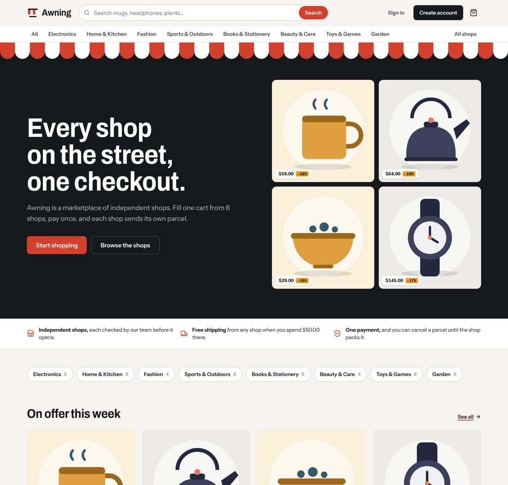
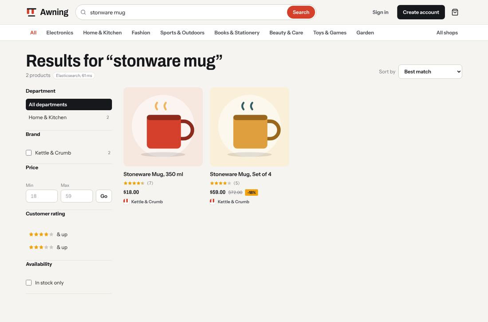
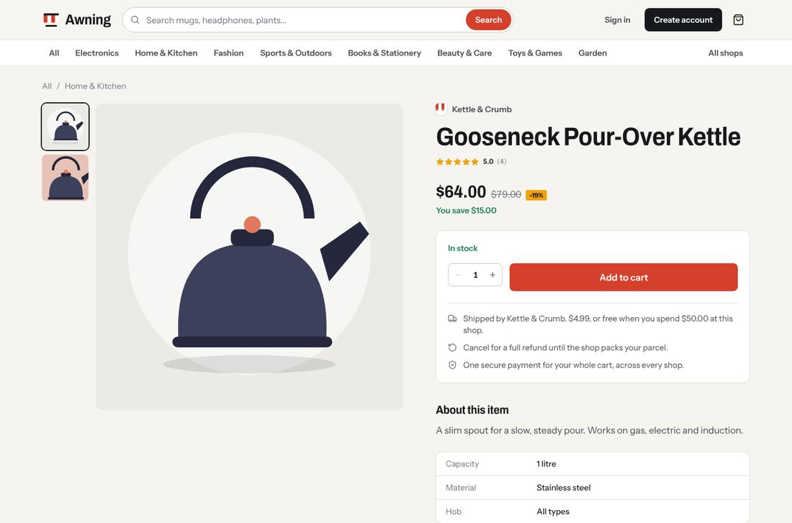
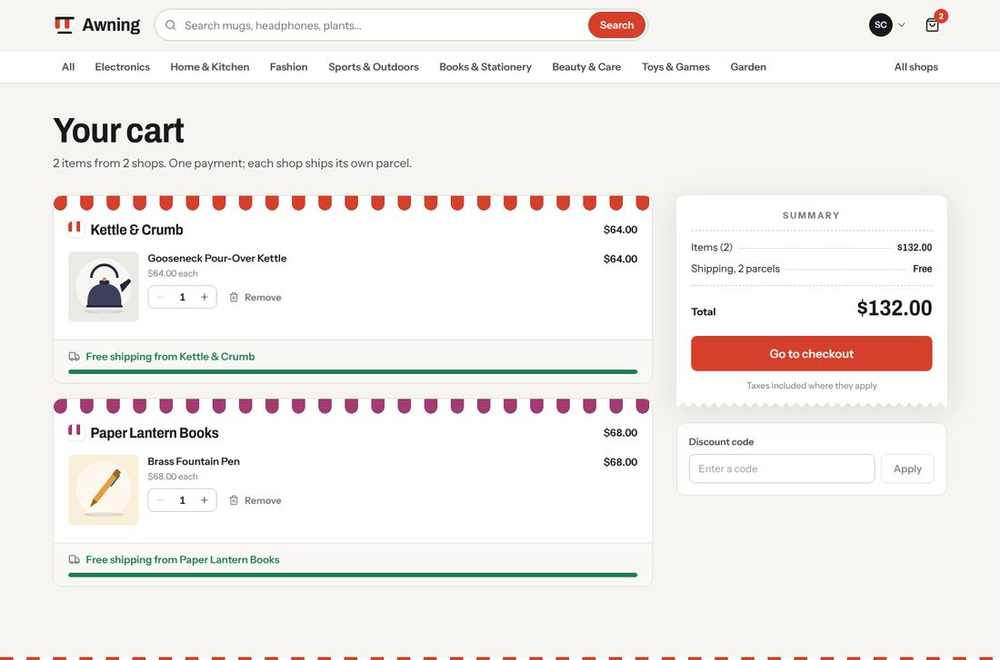
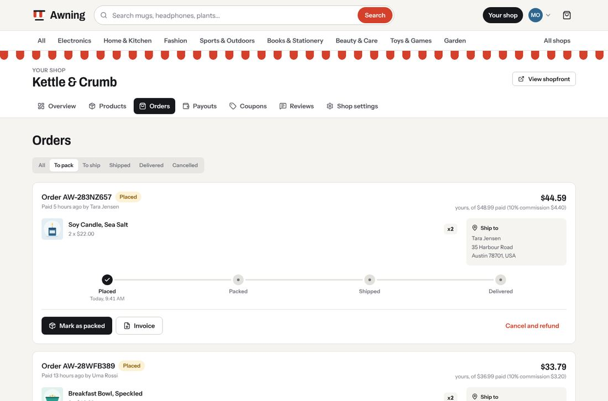
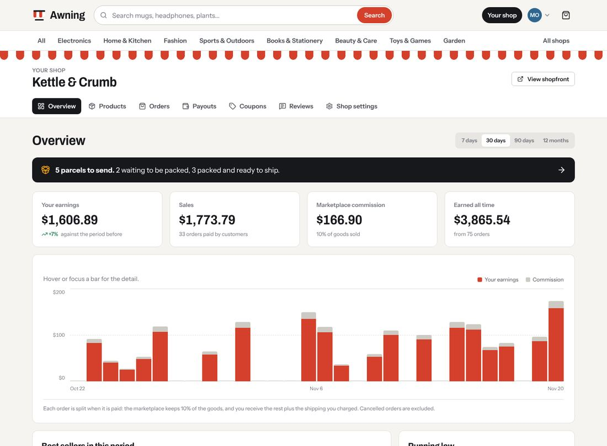
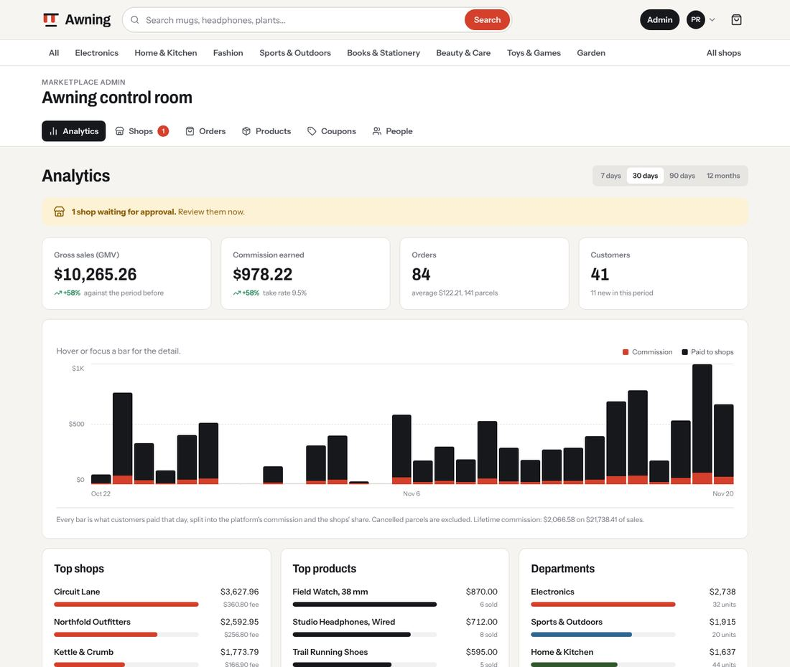

# Awning

A multi-vendor marketplace: many independent shops sell, customers fill one cart and pay once, and the platform
splits the payment between the shops and keeps a commission.

Built with React, Node.js, MongoDB, Elasticsearch, Redis, AWS S3 and Stripe Connect or Razorpay Route.



## Quick start

```bash
npm install
npm run dev
```

Open http://localhost:5173. Needs Node.js 20+ and nothing else: the first start creates the `.env` files, starts
an embedded database if no MongoDB is running, and loads a demo marketplace (7 shops, 59 products, 173 orders,
135 reviews, 3 coupons).

Demo accounts, password `awning123` for all (the sign-in page has one-click buttons):

| Role | Email |
| --- | --- |
| Customer | `sam@awning.test` |
| Shop owner | `maya@awning.test` |
| Admin | `admin@awning.test` |

Test card `4242 4242 4242 4242`. Coupons `WELCOME10`, `BIGBASKET`, `KETTLE15`.

**Going live** (MongoDB Atlas, Redis, Elasticsearch, S3, Stripe Connect or Razorpay Route, backend on Render,
frontend on Vercel): follow [`SETUP_GUIDE.md`](SETUP_GUIDE.md) step by step.

## What the brief asked for, and where it is

| Step | Implementation |
| --- | --- |
| 1. Roles, schema, API list | Customer, vendor and admin roles. Mongoose models for users (with address book), vendors, products, coupons, orders (one parcel per shop inside each order) and reviews. `server/src/models/index.js`, [`docs/API.md`](docs/API.md), [`docs/ARCHITECTURE.md`](docs/ARCHITECTURE.md) |
| 2. JWT auth, role-based access | bcrypt passwords, JWT bearer tokens, `requireRole` / `requireVendor` guards, sessions cached in Redis and dropped the moment a role or shop status changes. `server/src/middleware/auth.js` |
| 3. Vendor onboarding, product CRUD, images to S3 | Shop application, admin approval, drafts while pending; product editor with up to 6 photos uploaded to S3, reorderable. `server/src/routes/vendor.js`, `server/src/services/storage.js` |
| 4. Search with filters and sorting through Elasticsearch | Typo-tolerant, relevance-ranked search; filters for department, brand, price, rating and stock; facet counts that ignore their own filter; six sort orders; as-you-type suggestions. The index stays in step with every product, shop and review change. `server/src/services/search/` |
| 5. Cart, checkout, order lifecycle, Redis | Carts live in Redis (guest carts merge at sign-in); server-side pricing with per-shop shipping; stock reserved atomically at checkout; each shop's parcel moves placed, packed, shipped (with tracking), delivered; customers cancel until packed, shops until shipped, with refunds. `server/src/services/{cart,pricing,orders}.js` |
| 6. Split payments and commissions | Stripe Connect (separate charges and transfers), Razorpay Route, or a built-in test gateway. Commission per shop, exact to the cent, recorded on every parcel; payouts, reversals and a ledger per shop. `server/src/services/payments/` |
| 7. Reviews, coupons, PDF invoices, admin analytics; separate deploys | Verified-purchase reviews with shop replies; percentage and fixed coupons, marketplace-wide or per shop; PDF invoices for customers and per shop; analytics for admins and shops. Backend on Render (`render.yaml`), frontend on Vercel (`client/vercel.json`). |

Beyond the brief: an admin control room (shop approval, per-shop commission rates, order intervention, product
moderation), a shop dashboard, local fallbacks for every external service, a `doctor` command that checks them all,
and a browser test suite.

| | |
| --- | --- |
|  |  |
|  |  |
|  |  |

## Commands

| Command | Purpose |
| --- | --- |
| `npm run dev` | API on port 4000 and web app on port 5173, with reload |
| `npm test` | 57 API and unit tests (63 with `TEST_ELASTICSEARCH_URL` set) |
| `npm run doctor` | Check MongoDB, Redis, Elasticsearch, S3 and the payment provider |
| `npm run seed:reset` | Wipe and reload the demo marketplace (`seed:photos` uses real DummyJSON photos) |
| `npm run reindex` | Rebuild the search index |
| `npm run create-admin -- email password "Name"` | Create an admin |
| `npm run build` then `npm start` | Production mode on one machine |
| `python3 scripts/e2e_smoke.py` | Browser journeys (needs Playwright) |

## Project layout

```
awning/
├── SETUP_GUIDE.md          run locally, then go live step by step
├── render.yaml             backend deploy (Render Blueprint)
├── docker-compose.yml      MongoDB, Redis, Elasticsearch for local development
├── Dockerfile              the API as a container
├── docs/                   architecture, API reference, test results, presentation outline
├── scripts/                setup.mjs, e2e_smoke.py
├── server/                 Express API
│   ├── .env.example        every setting, with placeholders
│   └── src/
│       ├── models/         Mongoose schemas
│       ├── routes/         auth, catalog, cart, orders, payments, vendor, admin
│       ├── services/       kv (Redis), search/, storage (S3), pricing, cart, orders, payments/, analytics, invoicePdf
│       ├── seed/           demo marketplace and generated product art
│       └── doctor.js       service checks
└── client/                 React 18, Vite, Redux Toolkit (RTK Query), Tailwind
    ├── vercel.json         frontend deploy
    └── src/pages/          storefront, cart, checkout, account, vendor/, admin/
```

## Documentation

- [`SETUP_GUIDE.md`](SETUP_GUIDE.md): local setup, production setup, every environment variable, troubleshooting
- [`docs/ARCHITECTURE.md`](docs/ARCHITECTURE.md): diagrams, data model, money flow, design decisions
- [`docs/API.md`](docs/API.md): every endpoint
- [`docs/TEST_RESULTS.md`](docs/TEST_RESULTS.md): test output and performance numbers
- [`docs/PRESENTATION_OUTLINE.md`](docs/PRESENTATION_OUTLINE.md): a 10-minute talk track

## Known limits

- Demo product pictures are generated illustrations; `npm run seed:photos` uses real photos from DummyJSON.
- Payouts go to the shop's Stripe or Razorpay connected account; tax documents and bank checks are left to the provider.
- Razorpay Route needs linked accounts created in the Razorpay dashboard; shops paste the `acc_` id.
- Prices are single-currency per deployment (`CURRENCY`).
