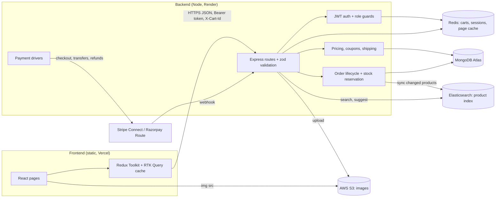
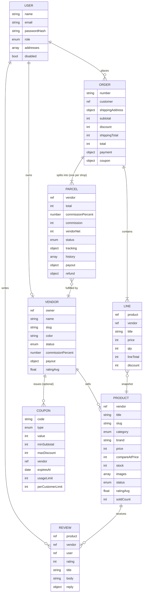
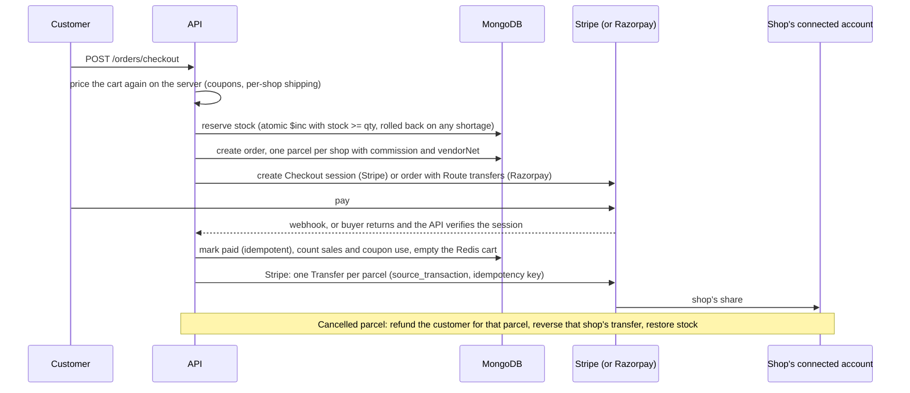

# Architecture

## System overview

Frontend and backend are deployed separately. The browser talks to the API with `VITE_API_URL`; the API accepts
browser requests only from `CLIENT_URL`. Images bypass the API: the browser loads them straight from S3 (or
CloudFront).

Every external service sits behind a small driver with a local fallback, so the project runs on a laptop with no
accounts, and each service is switched on by setting its environment variables:

| Concern | Production driver | Local fallback | Chosen by |
| --- | --- | --- | --- |
| Database | MongoDB (Atlas) | Embedded MongoDB | `MONGO_URI`, `MONGO_MEMORY_FALLBACK` |
| Carts, sessions, caches | Redis | In-memory map with the same interface | `CACHE_DRIVER` |
| Search | Elasticsearch / OpenSearch (REST API) | MongoDB queries with the same inputs and outputs | `SEARCH_DRIVER` |
| Images | S3 | Local disk served from `/media` | `STORAGE_DRIVER` |
| Payments | Stripe Connect or Razorpay Route | Built-in test gateway, same bookkeeping | `PAYMENT_PROVIDER` |

## Data model

Design notes:

- **One order, one parcel per shop.** A customer pays once, but each shop ships, tracks, cancels and gets paid for its
  own parcel (`order.vendorOrders`). The customer sees the least-advanced parcel as the order's overall status.
- **Money is integers in minor units.** Commission and the shop's share are computed once, when the order is created,
  and stored on the parcel, so changing a commission rate never rewrites history.
- **Snapshots.** Order lines keep the title, price, image and slug at purchase time, so archived or edited products
  never change past orders or invoices. Sold products are archived instead of deleted.
- **Denormalised counters** (`ratingAvg`, `ratingCount`, `soldCount`, `productCount`) keep catalog reads to one
  indexed query and are what Elasticsearch sorts on.

## Money flow

Worked example (from the test suite): a 10% shop and a 20% shop share an order with a marketplace coupon
capped at 8.00.

| | Shop A (10%) | Shop B (20%) |
| --- | --- | --- |
| Goods | 60.00 | 45.00 |
| Coupon share (in proportion) | -4.57 | -3.43 |
| Shipping | 0.00 (free over 50.00) | 5.00 |
| Customer pays | 55.43 | 46.57 |
| Platform commission | 5.54 | 8.31 |
| Shop receives | 49.89 | 38.26 |

Commission is taken on goods after discount; shipping goes to the shop in full. Every cent of the 102.00 the
customer paid is accounted for.

Safeguards:

- **No overselling.** Each line is reserved with a single conditional update; two buyers racing for the last unit
  get one 201 and one 409 (tested).
- **Abandoned payments.** Unpaid orders hold stock for 30 minutes; a sweeper releases them, and backing out of the
  payment step releases immediately.
- **Idempotent fulfilment.** Webhook and redirect can both arrive; only the first marks the order paid.
- **Shops paid later.** If a shop has not finished payout onboarding, its share stays `pending` and is sent once it does.

## Search

The search facade (`services/search/index.js`) offers `search`, `suggest`, `syncProducts`, `syncVendor` and
`reindexAll`. The Elasticsearch driver talks to the REST API with `fetch`, so it works unchanged with Elasticsearch
7 to 9, Elastic Cloud API keys and OpenSearch.

- **Mapping**: `title` as text with a `search_as_you_type` sub-field; brand, category and tags as keyword with text
  sub-fields; price, rating, sold count, stock and dates for filters and sorting.
- **Query**: three ways to match, any of which counts: all words across fields (`cross_fields`, highest boost),
  typo-tolerant (`fuzziness: AUTO`) and prefix (`bool_prefix`). Ties break on sales.
- **Facets**: department, brand and price ranges are computed with every filter except their own (filters are
  applied as `post_filter`), so a shopper can still see and add other options.
- **Consistency**: product saves, status changes, image changes, reviews, sales and shop approval or suspension
  re-index the affected products. The API also rebuilds the whole index at start-up, and `npm run reindex` does so
  on demand. Only active products of approved shops are indexed.
- **Resilience**: if the cluster fails on a live request, that request is answered by the MongoDB driver.

## Redis

| Key | Holds | Lifetime |
| --- | --- | --- |
| `cart:<userId>` / `cart:g_<browserId>` | `{ items: { productId: qty }, coupon }` | 30 days |
| `sess:<userId>` | The signed-in user's profile and shop status | 5 minutes, dropped on any change |
| `page:home` | The home page payload | 60 seconds, dropped on product and order changes |

Carts store only ids and quantities; prices, stock and coupons are re-evaluated on every read, so a cart can never
show a stale price. Guest carts are keyed by a random id the browser keeps and merge into the account at sign-in.

## Frontend

- **State**: two Redux slices (session, UI) and one RTK Query API definition for all server data, with tag-based
  invalidation. Cart mutations write the freshly priced cart straight into the cache; quantity changes and removals
  are optimistic and roll back on error.
- **Speed**: storefront pages are in the first bundle (about 19 KB gzip of app code); account, shop and admin areas
  are split out. Product pages are prefetched on hover. Search debounces typing and keeps the previous results on
  screen, dimmed, while new ones load.
- **Design**: a market street. Each shop picks an awning colour that appears as a striped, scalloped canopy on its
  shopfront, its parcels and its cart group. Totals are shown on a torn-off till receipt. Headings use Archivo
  (condensed, like shop signage), text uses Instrument Sans.
- **Accessibility**: labelled controls tied to hints with `aria-describedby`, a keyboard-navigable search combobox,
  focus-trapped dialogs, `aria-live` for results and toasts, reduced motion respected, layouts checked at 390 px.

## Security

- bcrypt password hashes; JWT bearer tokens; disabled accounts and role changes take effect on the next request.
- Role guards on every route, and ownership checks so a shop can only touch its own products, parcels and coupons.
- zod validation at every route boundary; PATCH routes accept only the fields that were sent.
- Prices, discounts, shipping and commission are computed only on the server.
- Customers never see commission figures; shops see only their own parcel of a shared order.
- Webhook signatures verified (Stripe signing secret, Razorpay HMAC); Razorpay checkout signatures verified.
- Uploads limited by type, size and count; the API's `/media` route sends a sandboxing content security policy.
- Rate limiting on sign-in and registration.
